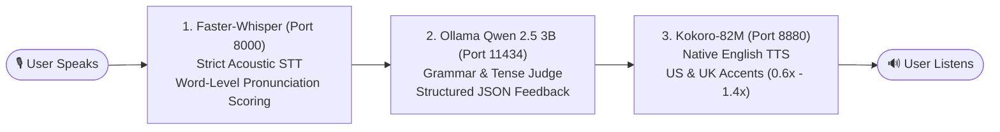

# English Practice with Local AI

An open-source, fully offline, privacy-focused English communication and pronunciation training platform powered by local lightweight AI models.

---

## 🏗️ Architecture & AI Pipeline



### System Resource Footprint
All three AI microservices run simultaneously on consumer hardware (tested on AMD Ryzen 5 5500GT with 32 GB RAM):

| Service | Engine | Model | Memory (RAM/VRAM) | Default Port |
| :--- | :--- | :--- | :--- | :--- |
| **Grammar Judge** | Ollama | `qwen2.5:3b` | ~2.2 GB | `11434` |
| **Strict STT** | Speaches / Faster-Whisper | `faster-whisper-base` | ~300 MB | `8000` |
| **Native TTS** | Kokoro-FastAPI | `kokoro-82m` | ~350 MB | `8880` |
| **Total Stack** | — | — | **~2.85 GB Total** | — |

---

## 📁 Repository Structure

```text
.
├── apps/
│   ├── frontend-english/     # React / TypeScript / Vite client application
│   └── serverless/           # Backend API orchestration layer
├── packages/
│   └── types/                # Shared TypeScript contracts and types
├── opensource/               # Self-hosted local AI engines with developer testbenches
│   ├── ollama-qwen2-5/       # Qwen 2.5 3B LLM (Grammar grading & feedback)
│   ├── faster-whisper/       # Faster-Whisper Base STT (Pronunciation evaluation)
│   └── tts-kokoro/           # Kokoro-82M TTS (Native US & UK voice synthesis)
├── turbo.json                # Turborepo build pipeline
└── package.json              # Monorepo configuration
```

---

## 🚀 Quickstart: Local AI Microservices

Each service in [`opensource/`](./opensource) is completely zero-config and self-contained with its own interactive testing playground.

### 1. Grammar Evaluator (Ollama Qwen 2.5 3B)
```bash
cd opensource/ollama-qwen2-5
npm start
```
- **API Endpoint:** `http://localhost:11434/api/chat`
- **Web Testbench:** Displays dynamic link on startup (includes live `fetch()` code generator).
- **Stop:** `npm run stop`

### 2. Speech-to-Text & Pronunciation Judge (Faster-Whisper)
```bash
cd opensource/faster-whisper
npm start
```
- **API Endpoint:** `http://localhost:8000/v1/audio/transcriptions`
- **Features:** Strict acoustic decoding (`temperature: 0.0`), word-level confidence badges to identify mumbled/mispronounced words.
- **Stop:** `npm run stop`

### 3. Native Voice Synthesizer (Kokoro-82M TTS)
```bash
cd opensource/tts-kokoro
npm start
```
- **API Endpoint:** `http://localhost:8880/v1/audio/speech`
- **Features:** Studio-quality American (`af_heart`, `am_adam`) and British (`bf_alice`, `bm_george`) accents with pacing control (`0.6x` – `1.4x`).
- **Stop:** `npm run stop`

---

## 💻 Running the Monorepo Apps

Install root dependencies and start all web applications via Turborepo:

```bash
# Install root dependencies
npm install

# Start all frontend and backend apps in dev mode
npm run dev
```

---

## 🔌 API Integration Cheat Sheet

All three engines adhere to standard OpenAI-compatible and REST endpoints:

### A. Grammar Evaluation (Qwen 2.5 3B)
```javascript
const response = await fetch('http://localhost:11434/api/chat', {
  method: 'POST',
  headers: { 'Content-Type': 'application/json' },
  body: JSON.stringify({
    model: 'qwen2.5:3b',
    messages: [
      { role: 'system', content: 'You are an English grammar evaluator. Assess the user sentence.' },
      { role: 'user', content: "She don't likes to goes to the market yesterday." }
    ],
    format: 'json',
    stream: false,
    options: { temperature: 0.2, num_ctx: 2048 }
  })
});
const { message } = await response.json();
console.log(message.content);
```

### B. Speech-to-Text & Word Confidence (Faster-Whisper)
```javascript
const formData = new FormData();
formData.append('file', audioBlob, 'audio.wav');
formData.append('model', 'Systran/faster-whisper-base');
formData.append('language', 'en');
formData.append('temperature', '0.0'); // Forces strict acoustic alignment
formData.append('response_format', 'verbose_json');
formData.append('timestamp_granularities[]', 'word');

const response = await fetch('http://localhost:8000/v1/audio/transcriptions', {
  method: 'POST',
  body: formData
});
const { text, words } = await response.json();
// words contain: [{ word: "market", probability: 0.94, start: 0.4, end: 0.8 }]
```

### C. Text-to-Speech (Kokoro-82M)
```javascript
const response = await fetch('http://localhost:8880/v1/audio/speech', {
  method: 'POST',
  headers: { 'Content-Type': 'application/json' },
  body: JSON.stringify({
    model: 'kokoro',
    input: 'Great job! Your pronunciation of the word "phenomenal" was spot on.',
    voice: 'af_heart', // af_heart, am_adam, bf_alice, bm_george
    speed: 1.0,
    response_format: 'mp3'
  })
});
const audioBlob = await response.blob();
const audioUrl = URL.createObjectURL(audioBlob);
new Audio(audioUrl).play();
```

---

## 🛡️ License
Distributed under the [MIT License](LICENSE) — free for public and commercial use.

